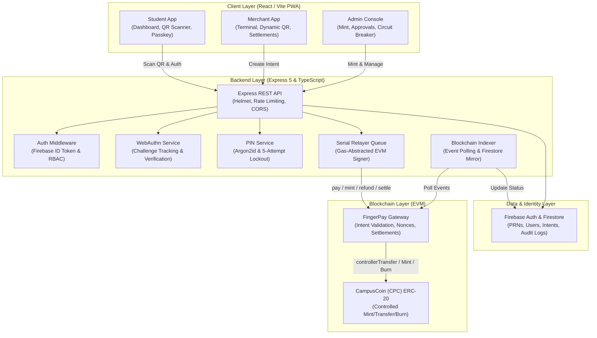

# FingerPay (CampusCoin)

FingerPay is a closed-loop biometric campus payment system powered by **CampusCoin (CPC)** — a zero-decimal utility token governed by smart contracts on an EVM blockchain. It combines WebAuthn passkeys (FIDO2/biometrics), Argon2id PIN verification, and a gas-abstracted relayer architecture for campus transactions.

---

## 1. System Architecture



---

## 2. Key Features

- **Closed-Loop Currency (CPC)**: Zero-decimal token with strictly non-transferable public ERC-20 methods; transfers occur only via approved controller gateways.
- **Biometric WebAuthn & Argon2id PIN**: Hardware-backed biometric authentication (TouchID, FaceID, Android Biometrics) paired with brute-force resistant Argon2id PIN hashes.
- **Zero Raw Biometric Storage**: Biometric samples never leave the user's device. The server stores only public keys and credential IDs.
- **Gas Abstraction**: Students and merchants do not pay gas or hold cryptocurrency wallets. The backend relayer submits transactions on their behalf.
- **Strict Role-Based Access Control**: Separate privilege domains for Students (`user`), Merchants (`merchant`), and Campus Accounts (`admin`).
- **Emergency Circuit Breaker**: Administrative contract pause halts all payment and minting activity instantly during incident response.

---

## 3. Quickstart (Under 20 Minutes)

### Prerequisites
- **Node.js**: `22.x` or `24.x`
- **Corepack / pnpm**: `corepack pnpm` (v12.18.0)
- **Java 21+**: (Required only if running local Firebase emulators)

### Step 1: Clone & Install Dependencies
```powershell
git clone <repository-url>
cd FingerPay
corepack pnpm install
```

### Step 2: Environment Configuration
Copy the safe default environment configuration:
```powershell
cp .env.example .env
cp .env.example packages/backend/.env
```

Ensure `.env` contains:
```env
PORT=4000
NODE_ENV=development
FIREBASE_PROJECT_ID=fingerpay-48317
CORS_ORIGINS=http://localhost:5173,http://127.0.0.1:5173
RPC_URL=http://127.0.0.1:8545
CHAIN_ID=31337
RELAYER_PRIVATE_KEY=0x59c6995e998f97a5a0044966f0945389dc9e86dae88c7a8412f4603b6b78690d
ADMIN_PRIVATE_KEY=0xac0974bec39a17e36ba4a6b4d238ff944bacb478cbed5efcae784d7bf4f2ff80
WALLET_SALT=fingerpay-demo-salt-at-least-32-chars-long
WEBAUTHN_RP_ID=localhost
WEBAUTHN_RP_NAME=FingerPay
WEBAUTHN_ORIGIN=http://localhost:5173
```

### Step 3: Start the Local Blockchain Node & Deploy Contracts
Terminal 1:
```powershell
corepack pnpm --filter @fingerpay/contracts node
```
Terminal 2:
```powershell
corepack pnpm deploy:local
```

### Step 4: Seed Demo Accounts
```powershell
corepack pnpm demo:seed
```
This populates:
- **Admin**: `admin@campus.edu` / `Password123!`
- **Merchants**: `canteen@campus.edu`, `bookstore@campus.edu`
- **Students**: `student1@campus.edu` through `student5@campus.edu` (pre-minted CPC, default PIN `9512`)
- **Allowlist PRNs**: `PRN2026001` .. `PRN2026010`

### Step 5: Start Backend and Frontend
Terminal 3 (Backend):
```powershell
corepack pnpm --filter @fingerpay/backend start
```
Terminal 4 (Frontend):
```powershell
corepack pnpm dev
```

Open `http://localhost:5173` in your browser. Refer to [`docs/DEMO_SCRIPT.md`](docs/DEMO_SCRIPT.md) for the guided evaluation script.

---

## 4. Verification & Testing

Run all quality and security checks:

```powershell
# Linting & Formatting
corepack pnpm lint

# TypeScript Typecheck Across All Workspaces
corepack pnpm typecheck

# Unit & Adversarial Security Tests
corepack pnpm test

# Production Build
corepack pnpm build
```

Individual phase integration suites:
```powershell
corepack pnpm test:phase2   # Backend foundation & chain connectivity
corepack pnpm test:phase3   # Onboarding & PIN Argon2id lockout
corepack pnpm test:phase4   # Payment pipeline & WebAuthn consumption
corepack pnpm test:phase5   # Refunds, settlements & pause controls
corepack pnpm test:phase8   # 16 Adversarial security tests
```

---

## 5. Repository Structure

```
FingerPay/
├── docs/                      # Architectural specifications & guides
│   ├── BUILD_GUIDE.md         # Authoritative technical specification
│   ├── DEMO_SCRIPT.md         # Demonstration walkthrough (7 scenes)
│   ├── REPORT_MATERIAL.md     # Measured gas, latencies, and metrics
│   ├── THREAT_MODEL.md        # Comprehensive threat & security model
│   └── PROGRESS.md            # Verified phase progression ledger
├── packages/
│   ├── contracts/             # Solidity contracts (CampusCoin, FingerPay)
│   ├── shared/                # Zod validation schemas, types & ABIs
│   ├── backend/               # Express 5 server, WebAuthn & relayer
│   └── frontend/              # React 19 / Vite / Tailwind UI
├── deployments/               # Network contract addresses
└── scripts/                   # Integration tests and demo seed scripts
```

---

## 6. Security & Compliance Disclaimers

- **Zero Monetary Value**: CampusCoin (CPC) is an educational demonstration closed-loop token. It cannot be exchanged for real money, fiat currencies, or external cryptocurrencies.
- **Biometric Privacy**: Fingerprint and biometric templates remain entirely inside the device's hardware enclave / authenticator. Server-side storage is restricted to W3C WebAuthn public keys and credential IDs.
